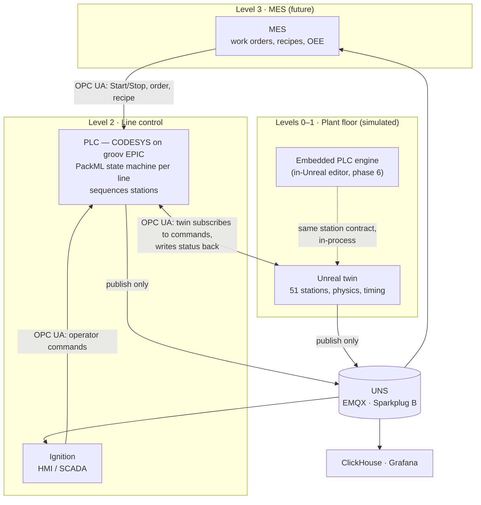

# OPC UA control, MQTT for the UNS, MES-ready

**Status:** plan, 2026-10-16. Supersedes the control half of
[`plc-digital-twin-plan.md`](plc-digital-twin-plan.md); its commissioning notes
and hardware facts still hold.

## In one screen

- **Commands go over OPC UA. MQTT carries data only.** Sparkplug B stays as the
  UNS feed (ClickHouse, Grafana, Ignition all keep working); nothing commands a
  station over MQTT anymore.
- **The PLC is the OPC UA server; the twin is a client.** That is how virtual
  commissioning tools connect to a real PLC, and it means the PLC program cannot
  tell the twin from real machines.
- **The loop closes for free.** Today's biggest gap — the PLC cannot see the
  twin's `busy`/`ready` because PAC Control has no Sparkplug decoder — vanishes:
  the twin writes them straight into the PLC's own variables.
- **Target CODESYS on the EPIC.** It runs on groov EPIC (firmware ≥ 3.5.0) under a
  **free** Opto 22 licence, speaks all IEC 61131-3 languages, has an OPC UA
  server built in, and imports PLCopen XML — which is what makes an Unreal-side
  editor possible. PAC Control stays supported during the migration.
- **MES talks to the PLC, never to the twin.** The twin replaces the plant floor
  (ISA-95 levels 0–1). A future MES commands the line through a PackML interface
  on the PLC, exactly as it would in a real plant.

---

## 1. Target architecture



**One owner at a time.** Every station takes commands from exactly one *control
source*: the twin's own sequencer (standalone demo), the embedded PLC engine, or
an external PLC over OPC UA. Switching is explicit and logged. This generalises
today's `EFactoryControlMode { Local, External }`.

---

## 2. Decisions

| Decision | Choice | Why |
|---|---|---|
| Control protocol | **OPC UA** | Request/response with confirmed writes, typed variables, methods, security. MQTT is fire-and-forget pub/sub — right for a UNS, wrong for an interlock. |
| UNS | **Sparkplug B, publish-only** | Already feeding ClickHouse, Grafana and Ignition; the pinned alias map and the bridge stay untouched. DCMD kept only for Sparkplug's mandatory `Node Control/Rebirth`. |
| UNS encoding | **Switchable: protobuf, JSON, or both** — built (§5.1) | Ignition needs protobuf; a JSON stream lets a broker rule or database ingest directly with no decoder sidecar. |
| Who is server | **PLC = server, twin = client** | Standard virtual-commissioning topology; any PLC with an OPC UA server works unchanged. A twin-side server is an optional later phase (§7). |
| PLC runtime | **CODESYS on the EPIC**, PAC Control during migration | Free licence on EPIC; IEC 61131-3 LD/ST/SFC/FBD; PLCopen XML import; built-in OPC UA server. PAC Control's format is proprietary and OptoScript-only. |
| Interface granularity | **Equipment module per station** (PackML-lite), not raw I/O | Matches the station model the sim already has; ~12 signals per station instead of hundreds of bits. Raw-I/O mode can be added per station later. |
| Handshake | **Sequence numbers, not pulses** | Generalises today's trigger *counter*, which is why it never loses a trigger. A pulse shorter than the OPC UA publishing interval can vanish; a counter cannot. |
| MES boundary | **PackML at line level, on the PLC** | ISA-TR88 PackML and its OPC UA companion spec (OPC 30050) are what MES vendors integrate against. |
| OPC UA stack | **open62541** (C99, MPL-2.0), vendored as a ThirdParty module | Client *and* server in one library, so tests run against an in-process server with no PLC attached. MPL-2.0 is file-level copyleft only. |
| Languages in the Unreal editor | **LD first, then SFC, then ST** | Not STL/IL: Instruction List is deprecated in IEC 61131-3 (3rd ed.), and Siemens STL has no future in TIA Portal. ST is its replacement. |

---

## 3. The station contract

The single most important artefact: every control source — PLC, embedded engine,
local sequencer — drives a station through exactly these signals. They extend
what the sim already exposes (`FactoryControlCommands`, `FactoryControlMetrics`,
`EFactoryMachineState`), so nothing is invented that the twin cannot already do.

OPC UA node naming: `Line1.LOADER.Cmd.Seq`, `Line1.LOADER.Sts.State`, …
(CODESYS symbol configuration exposes exactly this shape from a struct array).

### Commands — PLC → twin

| Signal | Type | Meaning |
|---|---|---|
| `Cmd.Seq` | UDINT | Increment to issue a command. The twin acts once per new value — idempotent across reconnects. |
| `Cmd.Code` | USINT | 1 Start cycle · 2 Hold · 3 Unhold · 4 Reset fault · 5 Inject fault · 6 Abort |
| `Cmd.Enable` | BOOL | Level, not edge: false blocks the station (today's `Enable`). |
| `Cmd.RecipeId` | UINT | Selects cycle parameters; 0 = station default. MES-facing. |
| `Cmd.PartId` | STRING | Optional: the part this cycle is for — genealogy from MES order to station. |

### Status — twin → PLC

| Signal | Type | Meaning |
|---|---|---|
| `Sts.AckSeq` | UDINT | Last `Cmd.Seq` accepted. `AckSeq = Seq` means "received". |
| `Sts.DoneSeq` | UDINT | `Cmd.Seq` of the last *completed* cycle. The PLC advances on this — this is the closed loop. |
| `Sts.State` | USINT | `EFactoryMachineState`: 0 Idle 1 Running 2 Fault 3 Blocked 4 Warmup 5 Cooldown. Existing values, unchanged. |
| `Sts.Ready` | BOOL | A Start would be accepted now (existing `ready`). |
| `Sts.Busy` | BOOL | Cycle in progress (existing `busy`). |
| `Sts.FaultCode` | UINT | 0 = none. |
| `Sts.CycleTime` | REAL | Last measured cycle, s. |
| `Sts.Good` / `Sts.Bad` | UDINT | Part counters — feed PackML `ProdProcessedCount` / `ProdDefectiveCount`. |
| `Sts.Heartbeat` | UDINT | Twin-side watchdog for the PLC (the mirror of today's PLC heartbeat). |

### The handshake

```
PLC                                   Twin
 Cmd.Code := 1; Cmd.Seq := 41   ──▶
                                ◀──   Sts.AckSeq := 41, Busy := TRUE
            (cycle runs, 3–6 s)
                                ◀──   Sts.DoneSeq := 41, Busy := FALSE
 sees DoneSeq = 41, moves the
 board, issues Seq 42 downstream
```

A rejected command (station faulted or disabled) sets `AckSeq` but never
`DoneSeq`, and leaves a `FaultCode`; the PLC times out on `DoneSeq`, not on
silence. Watchdogs: the PLC watches `Sts.Heartbeat`, the twin watches the PLC's
— 2 s each, because an Unreal frame hitch can take hundreds of milliseconds.

---

## 4. The MES-facing interface (line level, on the PLC)

A PackML unit per line, implemented in the PLC program — not in Unreal:

| PackML tag | Direction | Use |
|---|---|---|
| `Command.CntrlCmd` | MES → PLC | Reset, Start, Stop, Hold, Unhold, Suspend, Unsuspend, Abort, Clear |
| `Command.UnitMode` | MES → PLC | Production · Maintenance · Manual |
| `Command.Parameter[]` | MES → PLC | Order id, product/recipe id, target quantity |
| `Status.StateCurrent` | PLC → MES | The 17 PackML states (Idle, Execute, Held, Complete, Aborted…) |
| `Status.CurMachSpeed` | PLC → MES | Boards/min |
| `Admin.ProdProcessedCount` / `ProdDefectiveCount` | PLC → MES | Rolled up from the stations' `Good`/`Bad` |
| `Admin.StopReason` | PLC → MES | First-out fault — station and `FaultCode` |

The same values also go to the UNS (the PLC already publishes Sparkplug), so MES
*reads* KPIs from the UNS and *commands* over OPC UA — the split this whole plan
is built on.

Proof without an MES: a 100-line Python script using `asyncua` that plays MES —
issue an order for 50 boards on Line 2, wait for `Complete`, read the counts.

---

## 5. Code structure

### What is wrong today

1. **Sparkplug leaks into the simulation core.** `FactorySimTypes.h`,
   `FactoryLineSubsystem.h`, `FactoryMachineComponent.h` and
   `FactoryTwinSettings.h` all include Sparkplug headers, and
   `ApplyStationCommand` takes an `FSparkplugMetric`. OPC UA cannot be added
   cleanly until commands are transport-neutral.
2. **The runtime module cannot be packaged.** Nine commandlets — 5,685 of
   FactorySim's 10,071 implementation lines — include editor-only headers with
   no `WITH_EDITOR` guard, and their dependencies are only added when building
   the editor. A packaged demo, and the in-Unreal PLC editor with it, needs this
   fixed first. *(Inferred from the includes; no package build was run.)*

### Target modules

```
Plugins/FactoryTwin/Source/
  FactorySim/          Runtime  Stations, lines, parts, cycle model. No transport includes.
  FactorySimEditor/    Editor   The 9 commandlets, moved verbatim.
  FactoryControl/      Runtime  FStationCommand / FStationStatus, IFactoryControlSource,
                                control-source arbiter, local sequencer, watchdogs.
  FactoryOpcUa/        Runtime  open62541 client on a worker thread; OPC UA control source;
                                station ↔ NodeId mapping generated from the line layout.
  FactoryUns/          Runtime  Sim status → Sparkplug publisher (moved out of LineSubsystem).
  MqttTransport/       Runtime  Unchanged.
  SparkplugB/          Runtime  Unchanged; used publish-only.
  FactoryPlc/          Runtime  Phase 6: IEC IR, scan engine, PLCopen XML read/write.
  FactoryPlcUI/        Runtime  Phase 6: ladder editor widgets (UMG), live power flow.
  ThirdParty/open62541/         Vendored amalgamation, built as a static library.
```

**Dependency rule:** `FactorySim` depends on nothing above it. `FactoryControl`
depends on `FactorySim`. Transports and the PLC engine depend on
`FactoryControl`. Swapping PAC Control for CODESYS, or a PLC for an MES
simulator, touches one module.

`FactoryOpcUa` copies the threading pattern `MqttConnection` already uses: an
`FRunnable` drives `UA_Client_run_iterate`, results come back via
`AsyncTask(ENamedThreads::GameThread, …)`. Includes go through one private
header wrapped in `THIRD_PARTY_INCLUDES_START/END` and
`AllowWindowsPlatformTypes.h`, so open62541's Winsock includes cannot collide
with Unreal's.

### What retires, what stays

| Retires | Replaced by |
|---|---|
| Following a foreign Sparkplug edge node (`ObserveEdgeNode`, `HandleForeignNodeData`) | OPC UA subscription to the PLC |
| Station commands over DCMD (`HandleDeviceCommand`, `bEdgeSensitive`) | `Cmd.Seq` handshake |
| The right-to-left tag-name grammar (`ResolveCommandTarget`) | An explicit, generated station ↔ NodeId map |
| `PlcGroupId`, the underscore/colon group-id split | Not needed — the PLC is addressed by endpoint URL |

**Stays:** Sparkplug publishing, the pinned alias map, the ClickHouse bridge,
both Grafana dashboards, Ignition's UNS model, the local sequencer and the PLC
watchdog/fallback behaviour.

Keep the Sparkplug-following control source alive behind a setting until phase 4
passes, then delete it — two control paths for one station is how commands get
applied twice.

### 5.1 UNS payload encoding — built

`FSparkplugEdgeNodeConfig::Encoding` selects what goes on the wire:

| `Encoding` | Publishes | Use when |
|---|---|---|
| `Protobuf` (default) | Tahu protobuf on `spBv1.0/…` | Every consumer speaks Sparkplug. Spec-compliant. |
| `Json` | Tahu-shaped JSON on `JsonNamespace/…` | Nothing on the broker reads protobuf. |
| `Both` | Each message twice, same `seq` | Ignition reads protobuf *and* something else wants JSON. |

Set it in `Config/DefaultGame.ini` inside the existing `EdgeNode=(…)` line —
e.g. `…,EdgeNodeId="Line1",Encoding=Both,JsonNamespace="spBv1.0-json",Mqtt=(…)` —
or under Project Settings → Factory Twin → Edge Node. All three lines pick it up.

- **JSON gets its own namespace** (`spBv1.0-json` by default): a Sparkplug
  consumer on `spBv1.0` fails on JSON. It is one topic level, so level 2 is still
  the group and the existing Grafana queries' `splitByChar('/', topic)[2]` works
  on either stream. `Both` with the same namespace for both is refused at connect.
- **Exact numbers.** 64-bit integers go out and come back as exact text, never
  through a `double`; floats use the shortest text that reads back bit-identical.
- **Inbound is auto-detected** from the bytes, not the topic, so commands are
  accepted in either encoding on any stream the node publishes.
- **One will per connection.** With `Both`, an *abrupt* disconnect produces an
  NDEATH on the protobuf stream only; a clean one announces on both.
- **Do not ingest both streams into one table** — every value would land twice.
- **Removes the sidecar** only for consumers that read the JSON stream: e.g. an
  EMQX rule on `spBv1.0-json/#` writing straight to ClickHouse would replace
  `fde-spb-ch-bridge`. Ignition still reads protobuf.
- **gRPC is not a payload option.** gRPC is a request/response transport over
  HTTP/2, not something an MQTT broker carries; its wire format *is* protobuf,
  which the default mode already sends. Delivering to a gRPC endpoint instead of
  a broker would be a separate sink, and needs a named target and `.proto`.

Covered by `FactoryTwin.SparkplugB.Json.*` (known text, every datatype round
trip, protobuf/JSON equivalence, detection, lenient and malformed input) and
`FactoryTwin.SparkplugB.Live.BothEncodings` (needs the `Tools/broker` Mosquitto).

---

## 6. Phases

Each phase ends with an acceptance test, as in the original plan. Estimates are
rough working days for one person who knows this codebase.

| # | Phase | Passes when | Est. |
|---|---|---|---|
| 0 | **Verify the hardware assumptions.** Browse the EPIC with UaExpert: are PAC Control strategy variables visible over OPC UA, *and writable*? Activate the free CODESYS licence. Decide whether to keep PAC Control for phase 3 or go straight to CODESYS. | Twin-side status can be written into a PLC variable from UaExpert and read back by the strategy. | 1 |
| 1 | **Cut the seam.** `FactorySimEditor` split; transport-neutral `FStationCommand`/`FStationStatus`; `FactoryControl` module; today's Sparkplug following becomes one `IFactoryControlSource`. No behaviour change. | Existing automated tests pass; level4 runs identically under the PLC; a Game-target build compiles. | 4–6 |
| 2 | **OPC UA transport.** Vendor open62541; client on a worker thread; reconnect with backoff; subscriptions. | Automated test against an in-process open62541 server: subscribe, write, survive a server restart. | 4–5 |
| 3 | **One station, closed loop.** OPC UA control source; generated NodeId map; `Line1.LOADER` driven by the PLC with the `Seq/AckSeq/DoneSeq` handshake. | The PLC advances only on `DoneSeq`; stalling the twin stalls the PLC — the loop is demonstrably closed. | 3–4 |
| 4 | **Full plant on OPC UA; MQTT data-only.** All 51 stations; CODESYS program for three lines; Sparkplug following and station DCMD deleted. | The differential test again (drive Line 1, Lines 2–3 stay Blocked) over OPC UA; the Grafana "PLC vs Twin" conversion reaches ~100 %, because the PLC now waits instead of firing on offsets. | 5–8 |
| 5 | **MES-ready.** PackML unit per line in the PLC; station counters roll up; Python `asyncua` MES stand-in. | The stand-in orders 50 boards on Line 2, the line goes Execute → Complete, and the counts match ClickHouse. | 4–6 |
| 6 | **PLC editor inside Unreal.** IEC IR; ladder editor (contacts, coils, set/reset, TON/TOF/TP, CTU, compare, move); embedded scan engine; live power-flow view; PLCopen XML export. | A ladder program built in Unreal drives Line 1 through the embedded engine, *and* the same program exported to PLCopen XML imports into CODESYS and drives Line 1 from the EPIC — identical behaviour both ways. | 15–25 |
| 7 | *Optional:* SFC and ST in the editor; twin-side OPC UA server for PLCs that are clients; OPC UA PubSub. | — | — |

Phases 1–5 are roughly **4–6 weeks**; phase 6 is a project of its own.

### Phase 6, in more detail

- **One intermediate representation**, shaped like PLCopen XML (TC6): POUs,
  variables, rungs. Export is serialisation, not translation, and CODESYS,
  Beremiz and OpenPLC all import it.
- **The embedded engine is a real scan cycle**: latch inputs → evaluate rungs in
  order → write outputs, on a fixed 10 ms step independent of frame rate. It
  drives stations through the same station contract (§3), so the twin cannot
  tell it from the EPIC.
- **Variables bind by dragging a station tile onto a contact or coil**, and the
  binding is the §3 signal name — which is also the CODESYS symbol name, so an
  exported program needs no rewiring.
- **Runtime UMG, not an editor mode**, so it works in a packaged demo build —
  which is why phase 1's packaging fix comes first.
- **Not**: embedding CODESYS (proprietary, cannot be embedded) or round-tripping
  PAC Control (`.idb` is a closed format).

---

## 7. Risks

| Risk | Mitigation |
|---|---|
| groov's OPC UA server does not allow writes to PAC Control variables | Phase 0 gate. If writes fail, go straight to CODESYS for phase 3. |
| EPIC CPU was near its limit with Sparkplug publishing alone | Publish the plant's UNS data from the twin, not the PLC; keep OPC UA publishing intervals at 100 ms; the PLC publishes only its own line-level state. |
| Unreal frame hitches delay status writes | Handshake is sequence-based and timeouts are seconds, not scans; heartbeat watchdogs at 2 s. |
| open62541 vs Unreal on Windows (Winsock, macro clashes) | Isolated ThirdParty module, one wrapped include header, built as a static lib. |
| Two control sources drive one station during migration | The arbiter gives each station exactly one owner; the Sparkplug path is deleted at the end of phase 4, not left dormant. |
| Anyone mistaking this for real-time or safety control | Same rule as before: supervisory sequencing only. E-stops stay hardwired. |

---

## 8. Do not

- **Do not command over MQTT**, including "just for a demo". The split between a
  command plane and a data plane is the point; one exception erodes it.
- **Do not let MES write to the twin.** MES → PLC → twin. If MES can bypass the
  PLC in the twin, the twin no longer models the plant.
- **Do not hand-maintain the NodeId map.** Generate it from the line layout, as
  the PAC Control tag CSV was generated — 51 stations × 14 signals is 714 entries.
- **Do not add STL/IL** to the editor. Deprecated in the standard; ST replaces it.

## Sources

- [CODESYS (IEC 61131-3) on groov EPIC — Opto 22](https://www.opto22.com/products/groov-epic-system/groov-epic-software/codesys-(iec-61131-3))
- [GROOV-LIC-CRE, free CODESYS runtime licence — Opto 22](https://opto22.com/products/groov-lic-cre)
- [PAC Control variables exposed as OPC UA tags — Industrial Monitor Direct](https://industrialmonitordirect.com/blogs/knowledgebase/groov-epic-modbus-sharing-tags-between-view-and-pac-control) (secondary source; phase 0 verifies write access first-hand)
